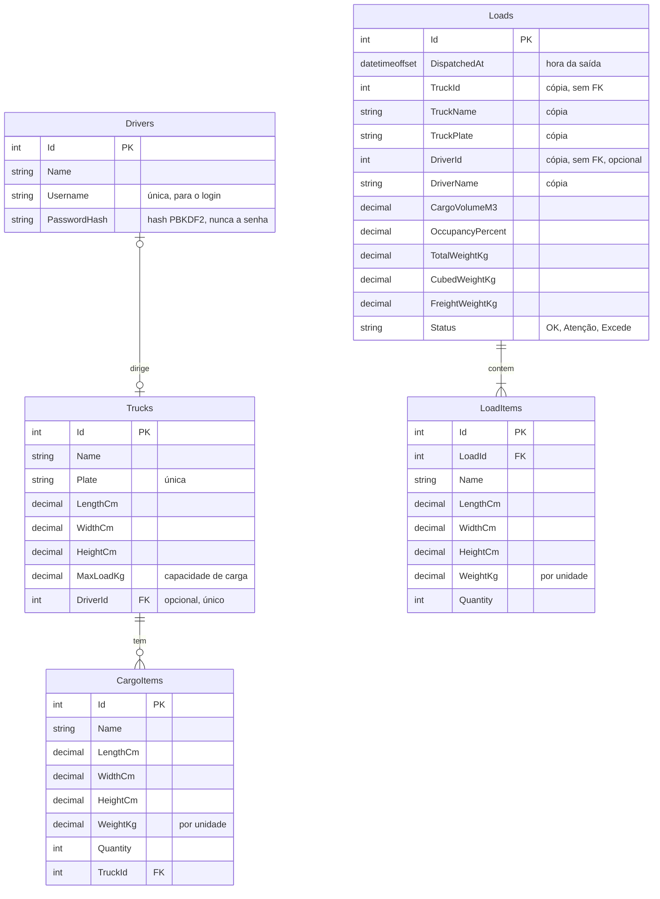
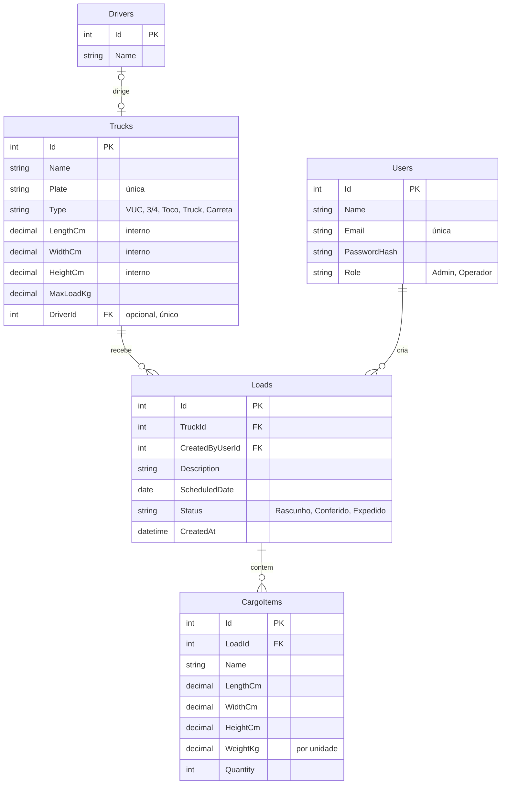

# Modelo de dados

Hoje são cinco tabelas: três do cadastro e duas do histórico de cargas.

## Atual

Motorista: nome, usuário e hash da senha (veja [Segurança e LGPD](07-seguranca-e-lgpd.md)). O caminhão tem no máximo um motorista e cada motorista fica em um caminhão só. Excluir o motorista deixa o caminhão sem motorista.

`CargoItems` é a carga que está no caminhão agora. Ao registrar a saída, ela é copiada para `Loads`/`LoadItems` e apagada do caminhão. O histórico guarda **cópias** (placa, nomes, resultados do cálculo) e não chaves estrangeiras para `Trucks` e `Drivers`: assim ele continua igual ao que saiu, mesmo se o caminhão ou o motorista forem alterados ou excluídos depois. É o mesmo princípio de uma nota fiscal.

Ainda não dá para planejar dois carregamentos para o mesmo veículo ao mesmo tempo: o modelo sugerido abaixo resolve isso.

## Sugerido

Notas:

- **Loads** (carregamento) liga caminhão e itens. É a mudança mais importante.
- Os resultados (volume, ocupação, peso cubado) **não** são gravados: são calculados na hora pela API. Assim nunca ficam desatualizados.
- Fator de aproveitamento e fator de cubagem podem ficar no `appsettings.json` da API. Uma tabela de configuração é opcional.
- **Users** só é necessária se o grupo fizer login. Se usar ASP.NET Core Identity, ele cria as próprias tabelas de usuário.

## Migrations

Hoje a API usa `EnsureCreatedAsync()`, que cria o banco mas não sabe alterá-lo depois. Ao adicionar campos, o banco antigo não muda: é preciso apagar o banco com `docker compose down -v` (perde os dados) e subir de novo. Trocar por migrations do EF Core (`dotnet ef migrations add` e `Database.MigrateAsync()`) resolve isso e é um bom ponto para mostrar no trabalho.
